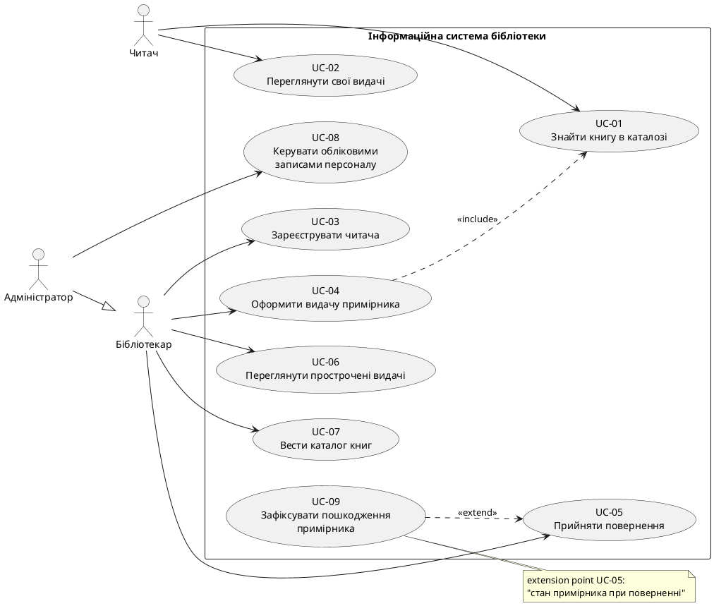

# Специфікація вимог: «Оформити видачу примірника читачу»

Система: інформаційна система міської бібліотеки. Модель даних — ER із Завдання 1 (`model.mmd`, `spec.md` лаби 1: AUTHOR, PUBLISHER, CATEGORY, BOOK, BOOK_COPY, READER, LOAN).

## 1. Опис предметної області та меж системи

Міська бібліотека дає читачам у тимчасове користування **фізичні примірники** книг (BOOK_COPY — конкретна копія з інвентарним номером; BOOK — видання в каталозі). Факт видачі фіксується записом LOAN (`loaned_at`, `due_date`, `returned_at`). Доступність примірника **не зберігається**, а обчислюється: примірник вільний, якщо немає LOAN з порожнім `returned_at` (AC-3, AC-11 лаби 1).

**Бізнес-цілі:** (1) знати, хто, що і до якого терміну взяв; (2) не видати один примірник двічі; (3) швидко обслуговувати чергу біля стійки; (4) мати історію видач.

**Проблеми, які розв'язує система:** паперовий облік, подвійна видача, відсутність видимості прострочень.

**Межі системи:** усередині — каталог, облік читачів, видач і повернень. Ззовні — читачі, персонал бібліотеки, поштовий сервіс, апаратні сканери, платіжні системи (див. розділ 9). Сама система актором не є.

## 2. Актори та їхні цілі

| Актор | Хто це | Цілі |
|---|---|---|
| Читач | зареєстрований відвідувач (READER) | знайти книгу; бачити свої видачі й терміни |
| Бібліотекар | працівник біля стійки видачі | реєструвати читачів, видавати й приймати примірники, вести каталог, бачити прострочення |
| Адміністратор | керівник/відповідальний за систему | усе, що Бібліотекар, + керувати обліковими записами персоналу |

Адміністратор узагальнює Бібліотекаря (`Адміністратор --|> Бібліотекар`): будь-яка дія бібліотекаря допустима й для адміністратора. Поштовий сервіс не є актором: він не ініціює взаємодію. Сканер, СУБД, модуль перевірки доступності — технічні компоненти, не актори.

## 3. Перелік Use Cases

| ID | Назва | Актор | Мета |
|---|---|---|---|
| UC-01 | Знайти книгу в каталозі | Читач (+ включається в UC-04) | дізнатися, чи є книга й чи є вільні примірники |
| UC-02 | Переглянути свої видачі | Читач | побачити, що взято й до якого терміну |
| UC-03 | Зареєструвати читача | Бібліотекар | створити запис READER |
| **UC-04** | **Оформити видачу примірника читачу** | **Бібліотекар** | **передати читачу примірник і зафіксувати це** |
| UC-05 | Прийняти повернення примірника | Бібліотекар | закрити видачу (`returned_at`) |
| UC-06 | Переглянути прострочені видачі | Бібліотекар | знайти боржників |
| UC-07 | Вести каталог книг | Бібліотекар | додавати/редагувати книги, авторів, видавців, категорії, примірники |
| UC-08 | Керувати обліковими записами персоналу | Адміністратор | видавати/відкликати доступ працівникам |
| UC-09 | Зафіксувати пошкодження примірника | Бібліотекар (розширює UC-05) | оновити `condition` при поверненні |

## 4. Use Case Diagram

Код діаграми також у файлі `usecase.puml` (зображення — `usecase.svg`/`usecase.png`).



Обґрунтування зв'язків:
- `UC-04 include UC-01` — щоб видати, бібліотекар завжди спершу знаходить книгу та її примірники; це спільна поведінка, повторно використана в UC-01.
- `UC-09 extend UC-05` — пошкодження виявляється лише іноді, під час повернення; без нього UC-05 завершується самостійно. Точка розширення — «стан примірника при поверненні».
- `Адміністратор --|> Бібліотекар` — адміністратор виконує всі дії бібліотекаря.
- **Перехід UC-04 → UC-03 (FR-02) — лише навігація**, а не `include`/`extend`: коли читача не знайдено, бібліотекар сам запускає UC-03 як окрему потребу; UC-04 після цього починається заново. Тому на діаграмі зв'язку між ними немає.
- Перевірка ролей, валідація дат, перевірка доступності — не UC, а кроки всередині UC-04.

## 5. Обраний UC: UC-04 «Оформити видачу примірника читачу»

| Поле | Значення |
|---|---|
| Актор | Бібліотекар (первинний); Читач присутній фізично, але в системі не діє |
| Мета | зафіксувати передачу конкретного примірника конкретному читачу з терміном повернення |
| Сутності | READER (читає), BOOK і BOOK_COPY (читає), LOAN (створює) |
| Передумови | бібліотекар автентифікований; читач і примірник фізично присутні на стійці |
| Постумова (успіх) | створено рівно один LOAN: `loaned_at` = поточна дата, `due_date` задано, `returned_at` порожнє |
| Постумова (відмова) | жодного нового LOAN, інші дані не змінені |
| Основний потік | 1) знайти читача; 2) знайти книгу (include UC-01) і обрати вільний примірник; 3) задати/прийняти термін; 4) підтвердити; 5) система створює LOAN і показує підтвердження |
| Чому складний | зачіпає 4 із 7 сутностей, має бізнес-правило AC-11, обчислювану доступність, політики читача, змагання за один примірник, пріоритет кількох причин відмови |

Припущення (деталі в DEFENSE.md): **P-1** стандартний строк 14 днів; **P-2** допустимий термін від 1 до 30 днів; **P-3** ліміт — щонайменше 5 відкритих видач блокує нову; **P-4** прострочена невидана книга блокує нові видачі; **P-5** «поточна дата» — час сервера, Europe/Kyiv; **P-6** читач ідентифікується за email або `reader_id`; **P-7** масштаб: одна бібліотека, ~10 000 читачів, ~50 000 примірників; **P-8** порядок перевірок і пріоритет причин відмови визначено в FR-14.

## 6. Gherkin-сценарії (кожен сценарій є user story)

```gherkin
Feature: Оформлення видачі примірника читачу
  Як бібліотекар,
  я хочу оформити видачу конкретного примірника зареєстрованому читачу,
  щоб бібліотека знала, хто, що й до якого терміну взяв.

  Background:
    Given бібліотекар автентифікований у системі
    And сьогодні 2026-11-10

  # SC-01 — основний. Story: як бібліотекар я видаю вільний примірник зі стандартним терміном.
  Scenario: SC-01 Успішна видача зі стандартним терміном
    Given існує читач "Іваненко Марія" з email "maria@example.com"
    And існує книга "Кобзар" з примірником "INV-00123" без відкритих видач
    And у читача немає прострочених видач і менше 5 відкритих видач
    When бібліотекар знаходить читача за email "maria@example.com"
    And знаходить книгу "Кобзар"
    Then система показує примірник "INV-00123" як вільний
    When бібліотекар обирає "INV-00123" і підтверджує видачу без зміни терміну
    Then створюється один запис видачі з loaned_at 2026-11-10 і due_date 2026-11-24
    And returned_at порожнє
    And система показує "INV-00123", назву "Кобзар", читача "Іваненко Марія" і термін 2026-11-24

  # SC-02 — альтернативний. Story: як бібліотекар я видаю книгу на нестандартний допустимий термін.
  Scenario Outline: SC-02 Видача з індивідуальним терміном повернення
    Given існує читач "Іваненко Марія" з email "maria@example.com" без прострочених видач
    And примірник "INV-00123" не має відкритих видач
    When бібліотекар знаходить читача за email "maria@example.com"
    And обирає примірник "INV-00123" і задає термін <днів> днів
    And підтверджує видачу
    Then створюється видача з due_date <дата>
    And returned_at порожнє
    And система показує термін <дата>

    Examples:
      | днів | дата       |
      | 1    | 2026-11-11 |
      | 7    | 2026-11-17 |
      | 30   | 2026-12-10 |

  # SC-03 — альтернативний. Story: як бібліотекар я обираю вільний примірник, коли частина копій книги вже на руках.
  Scenario: SC-03 Вибір вільного примірника серед кількох
    Given книга "Кобзар" має примірники "INV-00123" (є відкрита видача) і "INV-00124" (вільний, condition "добрий")
    And існує читач "Іваненко Марія" з email "maria@example.com" без прострочених видач
    When бібліотекар знаходить читача за email "maria@example.com"
    And відкриває список примірників книги "Кобзар"
    Then система позначає "INV-00123" як виданий, а "INV-00124" як вільний зі станом "добрий"
    When бібліотекар обирає "INV-00124" і підтверджує видачу
    Then створюється видача для примірника "INV-00124" зі стандартним терміном 2026-11-24
    And система показує "INV-00124", назву "Кобзар" і термін 2026-11-24

  # SC-04 — відмова. Story: як бібліотекар я хочу, щоб система не дозволила видати примірник, який уже на руках.
  Scenario: SC-04 Відмова: примірник уже виданий
    Given існує читач "Іваненко Марія" з email "maria@example.com" без прострочених видач
    And примірник "INV-00123" книги "Кобзар" має видачу з порожнім returned_at
    When бібліотекар знаходить читача за email "maria@example.com"
    And відкриває список примірників книги "Кобзар"
    Then система позначає "INV-00123" як виданий
    When бібліотекар обирає "INV-00123" і підтверджує видачу
    Then система відхиляє операцію з повідомленням "Примірник уже виданий"
    And нова видача не створюється
    And кількість відкритих видач примірника "INV-00123" дорівнює 1

  # SC-05 — відмова. Story: як бібліотекар я хочу знати, що читача немає в базі, і зареєструвати його окремою дією.
  Scenario: SC-05 Відмова: читача не знайдено
    Given у системі немає читача з email "new@example.com"
    When бібліотекар знаходить читача за email "new@example.com"
    Then система повідомляє "Читача не знайдено"
    And пропонує перейти до реєстрації читача
    And жодної видачі не створюється

  # SC-06 — відмова. Story: як бібліотекар я хочу, щоб система зупинила видачу читачу, який не виконує правил.
  Scenario Outline: SC-06 Відмова через політику видачі
    Given існує читач "Петренко Олег" з email "oleg@example.com", який <стан>
    And примірник "INV-00200" не має відкритих видач
    When бібліотекар знаходить читача за email "oleg@example.com"
    And обирає "INV-00200" і підтверджує видачу
    Then система відхиляє операцію з причиною "<причина>"
    And жодної видачі не створюється

    Examples:
      | стан                                                     | причина                         |
      | має відкриту видачу з due_date 2026-11-01                | Є прострочена видача            |
      | має 5 відкритих видач, жодна не прострочена              | Досягнуто ліміт відкритих видач |
      | має 6 відкритих видач, жодна не прострочена              | Досягнуто ліміт відкритих видач |

  # SC-07 — відмова. Story: як бібліотекар я хочу, щоб система не прийняла некоректний термін.
  Scenario Outline: SC-07 Відмова: некоректний термін повернення
    Given існує читач "Іваненко Марія" з email "maria@example.com" без прострочених видач
    And примірник "INV-00123" не має відкритих видач
    When бібліотекар знаходить читача за email "maria@example.com"
    And обирає "INV-00123", задає due_date <дата> і підтверджує видачу
    Then система відхиляє операцію з повідомленням "<повідомлення>"
    And жодної видачі не створюється

    Examples:
      | дата       | повідомлення                              |
      | 2026-11-09 | Термін раніше за дату видачі              |
      | 2026-11-10 | Мінімальний термін — 1 день               |
      | 2026-12-11 | Термін перевищує 30 днів                  |

  # SC-08 — відмова при змаганні. Story: як бібліотекар я хочу, щоб при одночасній видачі одного примірника двом читачам видача відбулась лише одна.
  Scenario: SC-08 Відмова: одночасні підтвердження одного примірника
    Given примірник "INV-00123" не має відкритих видач
    And бібліотекар А оформлює видачу "INV-00123" читачу "Іваненко Марія", а бібліотекар Б — читачу "Петренко Олег"
    And обидва вже знайшли свого читача й обрали "INV-00123"
    When обидва підтверджують видачу одночасно
    Then створюється рівно одна видача примірника "INV-00123"
    And іншому бібліотекарю система показує "Примірник уже виданий"
    And кількість відкритих видач примірника "INV-00123" дорівнює 1

  # SC-09 — відмова з кількома причинами. Story: як бібліотекар я хочу бачити одну зрозумілу причину відмови, коли порушено кілька правил.
  Scenario Outline: SC-09 Пріоритет причин відмови
    Given існує читач "Петренко Олег" з email "oleg@example.com", який <читач>
    And примірник "INV-00200" <примірник>
    When бібліотекар знаходить читача за email "oleg@example.com"
    And обирає "INV-00200", <термін> і підтверджує видачу
    Then система показує лише причину "<причина>"
    And жодної видачі не створюється

    Examples:
      | читач                                              | примірник                  | термін                   | причина                         |
      | має відкриту видачу з due_date 2026-11-01          | уже виданий                | без зміни терміну        | Примірник уже виданий           |
      | має прострочену видачу й 5 відкритих видач         | вільний                    | без зміни терміну        | Є прострочена видача            |
      | має 5 відкритих видач, жодна не прострочена        | вільний                    | задає due_date 2026-12-11 | Досягнуто ліміт відкритих видач |
```

Різні шляхи до однієї мети (видати примірник): SC-01 — стандартний; SC-02, SC-03 — альтернативні (інший термін; вибір серед кількох примірників); SC-04…SC-09 — відмови за різними причинами (зайнятий примірник, немає читача, політика читача, некоректний термін, змагання двох бібліотекарів, кілька порушень одночасно).

## 7. Функціональні вимоги (EARS)

| ID | Вимога |
|---|---|
| FR-01 | WHEN бібліотекар вводить email або reader_id, the system SHALL знайти читача й показати його `full_name` і `email`. |
| FR-02 | IF читача з указаним email або reader_id немає, THEN the system SHALL повідомити «Читача не знайдено» і запропонувати перехід до UC-03 (лише навігація, див. розділ 4). |
| FR-03 | WHEN бібліотекар обирає книгу, the system SHALL показати всі її примірники з `inventory_number`, `condition` і ознакою «вільний/виданий», обчисленою за наявністю LOAN з порожнім `returned_at`. |
| FR-04 | IF у момент підтвердження видачі обраний примірник має LOAN з порожнім `returned_at`, THEN the system SHALL відхилити видачу з повідомленням «Примірник уже виданий». |
| FR-05 | WHEN бібліотекар підтверджує видачу й усі перевірки пройдено, the system SHALL створити один LOAN із `reader_id`, `copy_id`, `loaned_at` = поточна дата та порожнім `returned_at`. |
| FR-06 | WHEN бібліотекар підтверджує видачу без указаного терміну, the system SHALL встановити `due_date` = `loaned_at` + 14 днів (P-1). |
| FR-07 | WHEN бібліотекар указує термін повернення від `loaned_at` + 1 день до `loaned_at` + 30 днів включно, the system SHALL використати його як `due_date` (P-2). |
| FR-08 | IF указаний `due_date` раніше за `loaned_at` + 1 день або пізніше за `loaned_at` + 30 днів, THEN the system SHALL відхилити видачу з повідомленням, яке називає порушену межу. |
| FR-09 | WHEN бібліотекар підтверджує видачу, WHILE читач має хоча б один LOAN з порожнім `returned_at` і `due_date` раніше за поточну дату, the system SHALL відхилити видачу з причиною «Є прострочена видача» (P-4). |
| FR-10 | WHEN бібліотекар підтверджує видачу, WHILE читач має щонайменше 5 LOAN з порожнім `returned_at` (прострочені враховуються), the system SHALL відхилити видачу з причиною «Досягнуто ліміт відкритих видач» (P-3). |
| FR-11 | WHEN LOAN створено, the system SHALL показати `inventory_number`, `title` книги, `full_name` читача та `due_date`. |
| FR-12 | IF видачу відхилено, THEN the system SHALL залишити всі дані без змін. |
| FR-13 | WHEN підтвердження видачі одного примірника надходять від двох бібліотекарів одночасно, the system SHALL створити рівно один LOAN і відхилити інше підтвердження за FR-04. |
| FR-14 | IF одночасно виконуються кілька умов відмови, THEN the system SHALL показати лише одну причину за порядком: 1) читача не знайдено (FR-02); 2) примірник уже виданий (FR-04); 3) прострочена видача (FR-09); 4) ліміт видач (FR-10); 5) некоректний термін (FR-08) (P-8). |

Порядок у FR-14 обрано так: спершу те, що не виправляється зміною даних читача (немає читача, зайнятий примірник), потім умови, які бібліотекар може усунути з читачем (прострочення, ліміт), останнім — введення, яке виправляється за секунду.

## 8. Нефункціональні вимоги (NFR)

Усі числові значення тут — **проєктні припущення**: вихідних матеріалів із цифрами немає. Масштаб — P-7 (одна міська бібліотека).

| ID | Категорія | Вимога | Умова перевірки |
|---|---|---|---|
| NFR-01 | Продуктивність | Пошук читача й показ списку примірників книги виконується за ≤ 1 с для 95% запитів. | БД: 10 000 читачів, 50 000 примірників, 500 000 LOAN; 5 одночасних користувачів; 200 запусків |
| NFR-02 | Час відгуку | Підтвердження видачі (від кліку до повідомлення) ≤ 2 с для 95% операцій, ≤ 5 с для 100%. | Те саме навантаження |
| NFR-03 | Навантаження | Система підтримує 10 одночасних сесій бібліотекарів і ≥ 300 видач за робочий день без деградації NFR-01/02. | Навантажувальний тест 10 віртуальних користувачів, 60 хв |
| NFR-04 | Цілісність | При 1000 паралельних спроб видати той самий примірник створюється рівно 1 LOAN, дублів немає. | Автотест із паралельними запитами на 1 `copy_id` |
| NFR-05 | Надійність | Резервна копія щодня; RPO ≤ 24 год, RTO ≤ 4 год. | Відновлення з копії на тестовому стенді |
| NFR-06 | Безпека | Вхід за логіном і паролем; пароль зберігається як хеш (bcrypt, cost ≥ 10); сесія завершується після 15 хв бездіяльності; канал лише HTTPS (TLS ≥ 1.2). | Огляд конфігурації; тест на тайм-аут |
| NFR-07 | Безпека | Створювати LOAN можуть лише Бібліотекар і Адміністратор; запит від ролі Читач повертає відмову 403. | Тест ролей: 3 ролі × операція видачі |
| NFR-08 | Захист даних | Кожне створення LOAN журналюється (хто, коли, `loan_id`); журнал зберігається ≥ 3 роки; `email` читача не показується іншим читачам. | Перевірка журналу після 10 тестових видач; тест видимості |
| NFR-09 | Доступність | Доступність ≥ 99,5% у години роботи (пн–сб 09:00–19:00, Europe/Kyiv) за календарний місяць. | Моніторинг за місяць |
| NFR-10 | Сумісність | Веб-інтерфейс коректно працює в останніх 2 мажорних версіях Chrome, Firefox, Edge, Safari на екрані ≥ 1280 px. | Ручний прогін SC-01 у кожному браузері |
| NFR-11 | Зручність | Новий бібліотекар після 15 хв навчання оформлює видачу (SC-01) за ≤ 60 с і ≤ 5 екранах/кроках (середнє по 5 новачках). | Тест із 5 новачками |
| NFR-12 | Доступність UI | Контраст тексту ≥ 4,5:1; уся видача виконується з клавіатури (WCAG 2.1 AA). | Перевірка інструментом і ручним проходом |
| NFR-13 | Локалізація | Інтерфейс українською; дати у форматі ДД.ММ.РРРР; дані в UTF-8, кирилиця в `full_name` і `title` не спотворюється. | Тест із 20 записами кирилицею |
| NFR-14 | Технологія | Веб-застосунок із реляційною СУБД з транзакціями та частковими унікальними індексами (напр. PostgreSQL ≥ 14); на робочому місці бібліотекаря потрібен лише браузер. | Огляд конфігурації; автотест NFR-04 проходить на цій СУБД |

NFR не нанесені на діаграму й не входять до матриці трасування.

## 9. Поза обсягом (Out of Scope)

| Пункт | Чому не входить |
|---|---|
| Бронювання книг | в ER немає сутності бронювання; не потрібне для UC-04 |
| Штрафи й оплата за прострочення | немає сутностей штрафу/платежу; потребує платіжної інтеграції |
| Email/SMS-нагадування читачам | поштовий сервіс не ініціює взаємодію; на цілі UC-04 не впливає |
| Інтеграція зі сканерами штрихкодів/RFID | технічна деталь, UC-04 виконується й вручну |
| Самообслуговування читача (видача без бібліотекаря) | змінює актора й ризики; інший UC |
| Продовження терміну видачі | окремий UC, у LOAN немає історії продовжень |
| Списання примірника | в ER немає атрибута списання (див. розбіжність №1) |
| Міжбібліотечний абонемент | поза межами однієї бібліотеки |
| Інтеграція із зовнішніми базами ISBN | каталог ведеться вручну (UC-07) |
| Детальна реалізація UC-01…03, 05…09 | завдання вимагає деталізувати лише один UC |

## 10. Матриця трасування

| Requirement ID | Requirement Description | Scenario ID | Use Case ID | Coverage / Status |
|---|---|---|---|---|
| FR-01 | Пошук читача | SC-01, SC-02, SC-03, SC-04, SC-05, SC-06, SC-07, SC-08, SC-09 | UC-04 | Покрито: крок пошуку є в кожному сценарії |
| FR-02 | Читача не знайдено → запропонувати реєстрацію | SC-05 | UC-04 (навігація до UC-03) | Покрито |
| FR-03 | Список примірників із обчисленою доступністю | SC-01, SC-03, SC-04 | UC-04, UC-01 | Покрито |
| FR-04 | Відмова: примірник уже виданий (на момент підтвердження) | SC-04, SC-08, SC-09 | UC-04 | Покрито |
| FR-05 | Створення LOAN | SC-01, SC-02, SC-03, SC-08 | UC-04 | Покрито |
| FR-06 | Стандартний строк 14 днів | SC-01, SC-03 | UC-04 | Покрито |
| FR-07 | Допустимий індивідуальний термін (1–30 днів) | SC-02 | UC-04 | Покрито |
| FR-08 | Відмова: некоректний термін | SC-07, SC-09 | UC-04 | Покрито |
| FR-09 | Відмова: прострочена видача | SC-06, SC-09 | UC-04 | Покрито |
| FR-10 | Відмова: ліміт ≥ 5 відкритих видач | SC-06, SC-09 | UC-04 | Покрито |
| FR-11 | Підтвердження видачі | SC-01, SC-02, SC-03 | UC-04 | Покрито |
| FR-12 | Відмова не змінює дані | SC-04, SC-05, SC-06, SC-07, SC-08, SC-09 | UC-04 | Покрито |
| FR-13 | Один LOAN при одночасних підтвердженнях | SC-08 | UC-04 | Покрито частково: поведінку показує SC-08, надійність під навантаженням — NFR-04 (NFR не трасуються) |
| FR-14 | Пріоритет причин відмови | SC-09 | UC-04 | Покрито вибірково: у SC-09 три з десяти можливих пар причин; решта випливає з порядку в FR-14 |

Зворотна перевірка (сценарій → вимоги):

| Scenario ID | Вимоги |
|---|---|
| SC-01 | FR-01, FR-03, FR-05, FR-06, FR-11 |
| SC-02 | FR-01, FR-05, FR-07, FR-11 |
| SC-03 | FR-01, FR-03, FR-05, FR-06, FR-11 |
| SC-04 | FR-01, FR-03, FR-04, FR-12 |
| SC-05 | FR-01, FR-02, FR-12 |
| SC-06 | FR-01, FR-09, FR-10, FR-12 |
| SC-07 | FR-01, FR-08, FR-12 |
| SC-08 | FR-01, FR-04, FR-05, FR-12, FR-13 |
| SC-09 | FR-01, FR-04, FR-08, FR-09, FR-10, FR-12, FR-14 |

**Сценарії без вимог:** немає. **Вимоги без сценаріїв:** немає; часткове покриття — FR-13 і FR-14 (див. таблицю). **UC, які не деталізуються:** UC-01 (лише через FR-03), UC-02, UC-03 (лише як навігація з FR-02), UC-05, UC-06, UC-07, UC-08, UC-09 — завдання вимагає деталізувати один UC; решта залишається на рівні назви й мети.

## 11. Аудит та ТОП-3 розбіжності

### 11.1 Функціональні вимоги
| Перевірка | Результат |
|---|---|
| Двозначності | Усунуто після рецензії: FR-07 (межі 1–30 днів), FR-10 («щонайменше 5»), FR-14 (порядок причин), FR-04 («у момент підтвердження»). Лишається: «поточна дата» залежить від часу сервера (P-5); невизначено, що робити, коли одна видача прострочена рівно в день `due_date` (вважаємо, що ні: прострочена, якщо `due_date` строго раніше за сьогодні) |
| Тестованість | кожна FR має вхід і спостережуваний вихід; FR-13 повністю тестується лише навантажувальним тестом (NFR-04), сценарій SC-08 це не замінює |
| Відповідність EARS | WHEN: FR-01, 03, 05, 06, 07, 11, 13; IF/THEN: FR-02, 04, 08, 12, 14; WHEN+WHILE: FR-09, 10. Конструкцій WHERE немає: опційних можливостей у цьому UC не обрано |
| Дублювання | FR-04 і FR-13 мають спільний наслідок (відмова), але різні тригери; FR-13 посилається на FR-04 |
| Суперечності | Виявлені й усунені: матриця обіцяла FR-01/FR-03 у сценаріях без відповідних кроків; SC-04 описував послідовну видачу, а FR-13 — одночасну; FR-07 і SC-02 допускали «0 днів». Нових не знайдено, але перевірка ручна, автоматичної немає |

### 11.2 NFR
Усі 14 мають число/межу й умову перевірки. Слабкі місця: усі числа — припущення без джерела; NFR-11 перевіряється на 5 людях, що статистично мало; NFR-09 вимірюється тільки за місяць експлуатації, тому до запуску не перевіряється; NFR-08 неможливо виконати без сутності персоналу (розбіжність №2).

### 11.3 Use Case Diagram
Актори — зовнішні люди; система й технічні компоненти не актори. `include` UC-04→UC-01 і `extend` UC-09→UC-05 (з точкою розширення) виправдані; генералізація Адміністратор→Бібліотекар виправдана. Зв'язок UC-04→UC-03 свідомо не показано (навігація). Слабке місце: UC-02 (вхід читача) і UC-08 (облікові записи) не мають опори в ER — див. розбіжність №2; UC-08 і UC-09 взагалі не деталізовані.

### 11.4 Узгодженість із ER (Завдання 1)
| Елемент специфікації | Сутність/атрибут ER | Статус |
|---|---|---|
| Актор Читач | READER (`full_name`, `email`, `registered_at`) | є; облікових даних (логін/пароль) немає |
| Актор Бібліотекар/Адміністратор | — | **немає сутності** |
| FR-01 | READER.`email`, `reader_id` | ок |
| FR-03 | BOOK_COPY.`inventory_number`, `condition`, BOOK.`title`; доступність із LOAN.`returned_at` | ок |
| FR-05, 06, 07 | LOAN.`loaned_at`, `due_date`, `returned_at` | ок |
| FR-04, 13 | AC-11 лаби 1 | ER не виражає; потрібне обмеження в БД |
| FR-09 | похідне з LOAN | ок (AC-3) |
| FR-10 (ліміт 5), FR-06/07 (14/1–30 днів) | — | параметри політики не мають місця в моделі |
| Списання примірника (R4) | — | **немає атрибута** |

### 11.5 ТОП-3 розбіжності та усунення

1. **Списання примірників не відображено в ER.** R4 (лаба 1) каже, що книга лишається в каталозі, коли «всі примірники списано», але BOOK_COPY не має ознаки списання; `condition` має лише «новий/добрий/зношений», а `status` заборонений AC-3. Система не може відрізнити списаний примірник від вільного й може його видати. *Усунення:* додати до BOOK_COPY необов'язковий `written_off_at` (date) і вимогу «не видавати списані». Альтернатива — значення «списаний» у `condition`; відхилено як змішування фізичного стану й облікового статусу.
2. **Немає сутності персоналу й облікових записів.** Дію виконує Бібліотекар, але LOAN не зберігає, хто видав; NFR-06/08, UC-08 і вхід читача в UC-02 не мають опори в моделі (ні для персоналу, ні для READER немає логіна/пароля). *Усунення:* додати STAFF (`staff_id`, `full_name`, `login`, `role`) і `staff_id` FK у LOAN; для UC-02 — облікові дані READER або винести UC-02 за межі. Мінімальна альтернатива: журнал поза ER, зафіксований у «Поза обсягом».
3. **Бізнес-правила LOAN і політика видачі не підкріплені моделлю.** AC-11 ER не виражає, а FR-04/FR-13 цього вимагають; параметри 14/1–30 днів і ліміт 5 не зберігаються. *Усунення:* частковий унікальний індекс `UNIQUE(copy_id) WHERE returned_at IS NULL` і CHECK на дати (NFR-14); параметри політики — у конфігурації, підтвердити в бібліотеки.

Інші спостереження: `er.md` у лабі 1 пошкоджений («countryerDiagram» обриває блок і вставляє другу копію діаграми), його треба перегенерувати з `model.mmd` (AC-9); формат ISBN, регістр email і nullable-поля залишаються відкритими питаннями лаби 1.